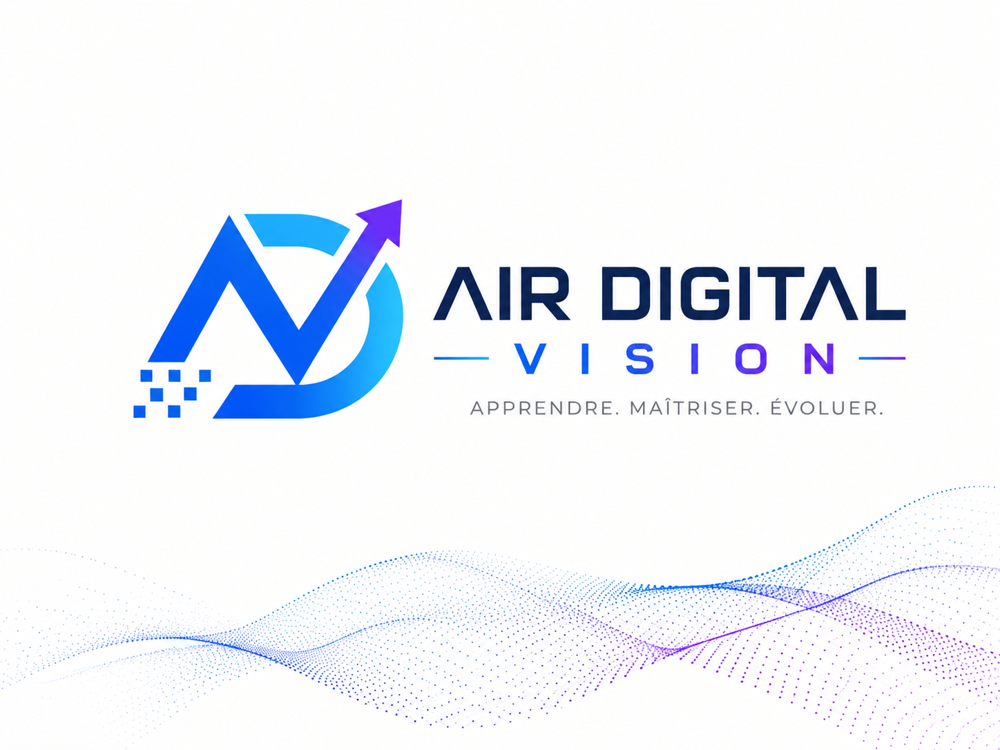

<!DOCTYPE html>
<html lang="fr">
<head>
<meta charset="UTF-8">
<meta name="viewport" content="width=device-width, initial-scale=1">
<meta name="description" content="Air Digital Vision : Airtable sur mesure et veille IA pour les professionnels.">
<link rel="icon" href="logo.png">
<title>Air Digital Vision — Automatisez, Anticipez, Avancez.</title>
<link href="https://fonts.googleapis.com/css2?family=Inter:wght@300;400;500;600;700;800;900&display=swap" rel="stylesheet">

</head>
<body>

<!-- NAV -->
<nav>
  
  

    <a href="#event" class="nav-event">📅 Événements</a>
    <a href="#problem">Problème</a>
    <a href="#solution">Solution</a>
    <a href="#demo">Démo</a>
    <a href="#diff">Atouts</a>
    <a href="#contact">Contact</a>
  

  <button class="nav-cta" onclick="document.getElementById('contact').scrollIntoView({behavior:'smooth'})">Parlons-en →</button>
</nav>

<!-- HERO -->
<section class="hero" id="hero">
  
  

SHAKATHON BIARRITZ 2026

  <h1>Automatisez, Anticipez, Avancez.</h1>
  
Airtable sur mesure + Veille IA — pour les professionnels qui veulent reprendre le contrôle de leur temps et de leur information.

  

    <a class="btn-primary" href="#demo">Voir la démo →</a>
    <a class="btn-secondary" href="#solution">Découvrir la solution</a>
  

  

    Administration digitale
    Airtable &amp; Automatisation
    Veille IA
  

</section>

<!-- ÉVÉNEMENTS -->
<section id="event">
  

    
Événements

    

      

        
🏄

        

          
SHAKATHON Biarritz

          
Cité de l'Océan · 25 sept. 2026 Hackathon IA &amp; Blockchain

          TERMINÉ
        

      

      

        
📊

        

          
Big BPI France

          
8 octobre 2026 Financement &amp; innovation entreprises

          8 OCT — À VENIR
        

      

      

        
⚙️

        

          
Airspace Airtable Paris

          
15 octobre 2026 Conférence IA &amp; Automatisation

          15 OCT — À VENIR
        

      

    

  

</section>

<!-- PROBLÈME -->
<section id="problem">
  

    
Le problème

    <h2 class="stitle">Deux problèmes qui coûtent cher à votre activité</h2>
    
PME, professions libérales, cabinets — tous perdent chaque semaine des heures sur des tâches sans valeur ajoutée, tout en manquant les informations critiques.

    

      

        
🗂️

        <h3 class="pb-title">L'administration dévore le temps</h3>
        <ul class="pb-list">
          <li>Devis, suivis clients, relances manuelles</li>
          <li>Reporting chronophage sans valeur ajoutée</li>
          <li>Gestion documentaire éparpillée</li>
        </ul>
        
+8h perdues

        
en moyenne par semaine

      

      

        
📡

        <h3 class="pb-title">L'information change trop vite</h3>
        <ul class="pb-list">
          <li>Réglementation et fiscalité en évolution constante</li>
          <li>Veille sectorielle impossible à tenir manuellement</li>
          <li>Décisions prises sans données à jour</li>
        </ul>
        
Flux ∞

        
d'information non maîtrisés

      

    

  

</section>

<!-- SOLUTION -->
<section id="solution">
  

    
Notre solution

    <h2 class="stitle">Deux offres. Un seul objectif : vous libérer du temps.</h2>
    
Chaque solution est construite sur mesure par un expert avec une maîtrise réelle des outils d'automatisation IA. On livre — pas une promesse.

    

      

        
01

        
⚙️

        
OFFRE 01 — AUTOMATISATION

        <h3 class="sol-title">Airtable sur mesure</h3>
        
On construit votre base Airtable et on automatise vos processus métier avec l'IA. Zéro code de votre côté — on s'occupe de tout.

        

          
→ Airtable : CRM clients &amp; suivi de missions personnalisé

          
→ Tableau de bord temps réel &amp; reporting automatisé

          
→ Facturation, relances &amp; workflows automatisés

          
→ Intégration Make / Claude API

          
→ Formation &amp; prise en main incluses

        

      

      

        
02

        
🔭

        
OFFRE 02 — INTELLIGENCE

        <h3 class="sol-title">Veille IA sur mesure</h3>
        
Chaque semaine, votre brief personnalisé sur ce qui compte vraiment — filtré par IA, synthétisé, livré directement. Zéro flux à gérer.

        

          
→ Actualités financières &amp; réglementaires filtrées par IA

          
→ Synthèse sectorielle livrée chaque semaine

          
→ Alertes sur les sujets critiques pour votre métier

          
→ Personnalisation totale selon votre secteur

          
→ Zéro friction — livraison directe

        

      

    

  

</section>

<!-- STATS & CIBLES -->
<section id="stats">
  

    
Impact &amp; cibles

    <h2 class="stitle">Ce que ça change concrètement</h2>
    

      

-8h

de tâches admin récupérées en moyenne par semaine

      

100%

sur mesure aucun outil générique

      

0

ligne de code requise de votre côté

    

    

      
Pour qui

      

        

🏢

PME &amp; ETI

Digitaliser les opérations sans recruter une DSI entière

        

📊

Cabinets comptables

Automatiser le répétitif, se concentrer sur le conseil à valeur ajoutée

        

⚕️

Professions libérales

Avocats, médecins, notaires — reprendre le contrôle de leur gestion

      

    

  

</section>

<!-- DÉMO -->
<section id="demo">
  

    
Démonstration

    <h2 class="stitle">Voyez-le en action</h2>
    
Accédez à la démo Airtable, à notre outil de veille et à nos contenus pour voir concrètement ce qu'on livre.

    

      

        
📊

        <h3 class="demo-title">Démo Airtable — Live</h3>
        
Découvrez notre workflow automatisé Airtable en situation réelle — présentation live

        <a class="demo-link" href="https://www.youtube.com/live/syCs8Jm9sCY?si=hwEpIwW8wlf0t43V" target="_blank">Voir la démo →</a>
      

      

        
🔭

        <h3 class="demo-title">Notre outil de Veille IA</h3>
        
Testez notre plateforme de veille informationnelle développée pour l'audit et la finance

        <a class="demo-link purple" href="https://veille-info-audit.vercel.app/" target="_blank">Accéder à la veille →</a>
      

      

        
▶️

        <h3 class="demo-title">Chaîne YouTube</h3>
        
Formations &amp; tutoriels IA, Airtable, Finance, Blockchain — contenu gratuit chaque semaine

        <a class="demo-link red" href="https://youtube.com/@web3kconcept" target="_blank">Voir la chaîne →</a>
      

    

  

</section>

<!-- DIFFÉRENCIANTS -->
<section id="diff">
  

    
Ce qui nous distingue

    <h2 class="stitle">Pas une promesse — un outil qui tourne.</h2>
    

      

🎓

<h4>Comptable avec plusieurs années d'expérience en cabinet</h4>
Formation DSCG, pratique terrain en cabinet d'expertise comptable — on connaît les vrais problèmes de la profession de l'intérieur.

      

🔐

<h4>Spécialiste des systèmes d'information &amp; sécurité IT</h4>
Maîtrise des architectures data, des protocoles de sécurité et des enjeux de conformité IT — vos données sont entre de bonnes mains.

      

📈

<h4>Finance de marché &amp; 10+ ans d'expérience professionnelle</h4>
Trading, analyse financière, blockchain — une vision globale qui enrichit chaque solution livrée.

      

⚙️

<h4>Maîtrise Airtable &amp; stack complète (Make, Claude API)</h4>
Des bases Airtable opérationnelles, des workflows qui tournent, des clients satisfaits dès le premier mois.

      

📊

<h4>ROI mesurable dès le premier mois</h4>
On définit ensemble les KPIs avant de commencer. Vous voyez l'impact — en heures économisées et en résultats concrets.

    

  

</section>

<!-- CONTACT -->
<section id="contact">
  

    
Contact

    <h2 class="stitle">Votre activité mérite de tourner sans friction.</h2>
    
Disponible pour une démonstration live. Contactez-nous — on vous répond sous 24h.

    

      
Fondateurs
Air Digital Vision Group

      
Événement à venir
Airtable — 15 oct. &amp; Big BPI — 8 oct.

      
Email
airdigitalvision@gmail.com

      
YouTube
@web3kconcept

    

    <a class="cta-hero" href="mailto:airdigitalvision@gmail.com">Échangeons →</a>
  

</section>

<!-- FOOTER -->
<footer>
  

    

    

      <a href="https://www.linkedin.com/company/airdigitalvision/" target="_blank" rel="noopener">LinkedIn</a>
      <a href="https://www.tiktok.com/@airdigitalvision" target="_blank" rel="noopener">TikTok</a>
    

    

      <a href="#" onclick="alert('Politique de confidentialité — à venir');return false">Politique de confidentialité</a>
      <a href="#" onclick="alert('Mentions légales — à venir');return false">Mentions légales</a>
      <a href="#" onclick="alert('Conditions générales — à venir');return false">CGU</a>
      <a href="mailto:airdigitalvision@gmail.com">Contact</a>
    

    
© 2026 Air Digital Vision Group — Tous droits réservés

  

</footer>

</body>
</html>
